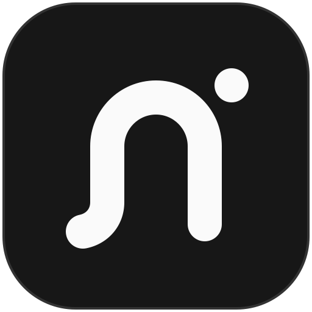

<p align="center">
  
</p>

<h1 align="center">neema</h1>

<p align="center">
  A self-hosted AI chat app for you and your team.<br>
  Bring any model, keep your data, and let it work with the web, your documents and your files.
</p>

<p align="center">
  <a href="https://github.com/ZerNico/neema/releases/latest">Download</a> ·
  <a href="#install">Install</a> ·
  <a href="#features">Features</a> ·
  <a href="CONTRIBUTING.md">Contributing</a>
</p>

---

## Features

**Chat with any model.** Connect OpenAI, Azure, Amazon Bedrock, OpenRouter or any
OpenAI-compatible server, including models you host yourself. Admins choose which
models people see and in what order.

**Answers that don't get lost.** Reload the page, switch devices or open a second tab
and a running answer carries on. Retry, edit, branch a chat, or queue the next message
while the model is still answering.

**Research.** Web search with cited sources, reading of pages and PDFs (scanned ones too),
and deep research that investigates a question across many sources.

**Your knowledge.** Knowledge collections the model can search, saved agents with their
own instructions, skills it loads when needed, and a memory of what you've told it.

**Projects.** Shared instructions, documents you edit together live, files and memory
for ongoing work, with each person's chats staying their own.

**Office files.** Create and edit Word, Excel and PowerPoint files in a chat, with
previews.

**Automation.** Scheduled prompts, custom tools written in TypeScript, and integrations
with Outline, Outlook and Jira, each person connecting their own account.

**Desktop app.** For macOS, Windows and Linux. Lets the model work in folders you grant
it, in a sandbox, and use a built-in browser with your approval.

**Made for teams.** Sign-in with email or any OAuth/OpenID Connect provider, open,
approval-based or closed sign-up, groups for sharing, and usage analytics.

## Install

neema is one container image, `ghcr.io/zernico/neema`. Run it however you run
containers. It needs:

- **PostgreSQL 17 with [pgvector](https://github.com/pgvector/pgvector).** The database
  user must be allowed to create the `vector`, `pg_trgm` and `unaccent` extensions, or
  you create them beforehand.
- **A volume at `/data`** for uploads, custom tools and downloaded OCR models.
- **A reverse proxy with TLS** in front of port 3000. It must serve the address you set
  as `PUBLIC_URL`, accept request bodies of at least 25 MB and not buffer responses,
  which would stall streaming answers.
- **An API key** for at least one model provider.

### Example: Docker Compose

[`infra/production/compose.yaml`](infra/production/compose.yaml) runs neema with
PostgreSQL and [SearXNG](https://github.com/searxng/searxng) for web search on one host.
Write its `.env` with fresh secrets, then start it:

```sh
git clone https://github.com/ZerNico/neema.git
cd neema/infra/production
cat > .env <<EOF
PUBLIC_URL=https://chat.example.com
AUTH_SECRET=$(openssl rand -base64 32)
ENCRYPTION_KEY=$(openssl rand -base64 32)
POSTGRES_PASSWORD=$(openssl rand -hex 24)
SEARXNG_SECRET=$(openssl rand -hex 32)
EOF
docker compose up -d
```

neema then listens on `127.0.0.1:3000` for your reverse proxy.

### First steps

Open the site. It asks you to create the admin account and choose who may sign up.
From the user menu, open **Admin** to:

1. add a model provider under **Providers** and pick its models,
2. add a search provider under **Tools** (`http://searxng:8080` with the compose example),
3. add sign-in providers under **Sign-in**.

### Configuration

Required

| Variable         | Example                                   |
| ---------------- | ----------------------------------------- |
| `DATABASE_URL`   | `postgres://neema:password@db:5432/neema` |
| `PUBLIC_URL`     | `https://chat.example.com`                |
| `AUTH_SECRET`    | output of `openssl rand -base64 32`       |
| `ENCRYPTION_KEY` | output of `openssl rand -base64 32`       |

> [!WARNING]
> Don't lose `ENCRYPTION_KEY`. It can't be recovered, and without it every stored API key
> and connected account is lost for good. Back it up somewhere safe, separate from the
> server.

Optional

| Variable               | Default                      |
| ---------------------- | ---------------------------- |
| `MIGRATE_ON_START`     | `true`                       |
| `CUSTOM_TOOL_REGISTRY` | `https://registry.npmjs.org` |

Everything else, from model providers to sign-in methods, is configured in the admin area.

### Updating

Pin a version tag such as `ghcr.io/zernico/neema:0.1.0` rather than following
`latest`. To update, change the tag and restart the container. Back up the database and
`/data` first. Migrations run on start. What changed, including any configuration you
need to adjust, is in the [release notes](https://github.com/ZerNico/neema/releases).

## Desktop app

Download the installer for your system from the
[latest release](https://github.com/ZerNico/neema/releases/latest) and enter your
server's address on first launch.

The installers aren't signed yet. On macOS, allow the app under **System Settings →
Privacy & Security** the first time it opens. On Windows, SmartScreen warns once.

## Contributing

See [CONTRIBUTING.md](CONTRIBUTING.md) for setting up a development environment, how the
code is organised and how releases are made.

## License

neema is licensed under the [GNU Affero General Public License v3.0](LICENSE). If you
run a modified version as a service for others, you must offer them its source code.
